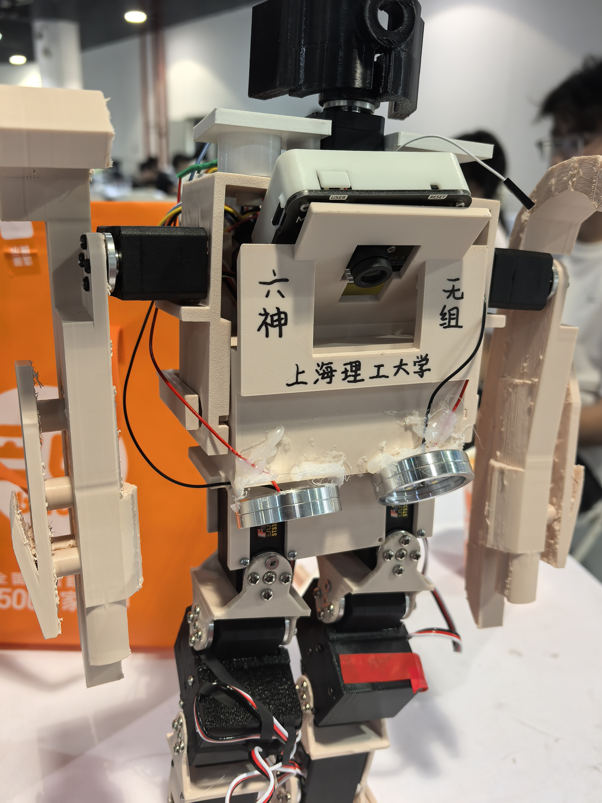
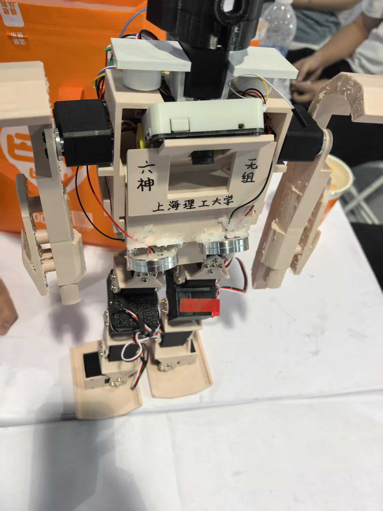

2026 Robocup 人形竞技全能赛项目资料

本项目包含基于 STM32F407、MaixCAM Pro 和 13 个 STS3215 舵机的人形机器人控制代码、视觉程序与机械资料。

机器人实物：

  
  

资料入口：

01_控制代码：Keil 工程、动作表、舵机控制和主机测试。

02_视觉代码：geometry_vision19.py，在 MaixCAM / MaixPy v4 环境中运行。

03_机械资料：STEP、SolidWorks 零件及 3MF 文件。

04_舵机上位机：工具使用说明，本机厂商程序不纳入 Git 提交。

控制实现说明见 [控制代码.md](控制代码.md)，接线、参数和资料目录见 [比赛资料整理说明.md](比赛资料整理说明.md)。

使用环境：Keil MDK，ARM Compiler 5.06 update 5；批处理脚本使用 PowerShell 7。主机测试另需 GCC，视觉决策测试使用 Python 3.11 或更新版本。
打开 01_控制代码/HumanoidRobot_HSI/MDK-ARM/HumanoidRobot_HSI.uvprojx 可进入工程。
使用编译.ps1 时，通过 -KeilExe 指定 UV4.exe 的安装路径，或设置 KEIL_UV4 环境变量。编译脚本不执行硬件下载。
测试方法见 01_控制代码/HumanoidRobot_HSI/Tests/README.md。当前源码配置不等同于实机已烧录版本。

原创内容暂未指定开源许可证，第三方组件适用各自许可证，详见 NOTICE。

以下保留我的经验与感悟：

关于这个机器人的一些经验以及感悟

1. 关于控制代码部分

我们采用的是freertos控制。实际上可能没必要，只是因为在校赛中，因为can通讯以及中断时序问题导致任务未完成，为了彻底避开这些问题而采用了freertos。

不过现在的agent已经非常好用了，对于代码的实现已经越来越容易。这还是要看大家自己了

不建议采用强化学习以及仿真训练，如果采用仿真训练，你得去记录所有部件的质量、重心、材料摩擦属性，还有舵机的中位校准偏差一点都有可能导致问题。周期可能会达到半年以上。

所以采用调步态的方式是一个较快方案

2. 关于机械部分

robocup的人形竞技自由度要求是13个以上。

目前市面上十分火的套件是幻尔机器人，他们腿部采用的就是一条腿5个舵机，髋关节内外一个自由度，大腿前后一个自由度，膝关节一个自由度，踝关节两个自由度。

这样的机械结构会稍微容易点，但是髋关节只有内外一个自由度会导致一个问题，那就是没有办法边走边转弯（在脚底和地面保持水平的前提下），所以幻尔采用的是通过使用脚底板蹭地板的方式去实现原地转弯，通过小幅度多次去达到目标位置，这样也不妨是一个好的策略。对于视觉可能有点要求

但是对与自制机器人来说，如果采用3D打印的机械结构，并且自己调步态，因为存在抖动以及舵机偏差，会产生晃动并且速度也没法这么快，难以调到商业机器人的效果。

所以在髋关节加入一个旋转自由度就是一个很好的解决方案（这个是在赛场上发现很多队伍都在采用这种方案），可以实现边走边转弯，不过实际调试难度可能会高出不少。

3. 对于一些舵机的一些选型推荐

我们采用的是飞特的ST3215，这个舵机有点长，个人感觉不太适合用于人形的腿，最终做出来的腿会非常长，因为这个腿我们改了很多版本才符合比例。

还有一些舵机虚位的来源，因为是双轴舵机，分为主动轴和从动轴，主动轴拧紧是没有问题的，但是这个从动轴就是通过塑料螺纹固定的，然后官方送的从动轴的螺丝又很短，后面我们换螺丝，把从动轴固定孔拧大了，导致从动轴始终固定不紧，会产生十分大误差。

还需要将连接件、法兰盘，舵机固定在一起，就是要通过螺丝将连接件、法兰盘舵机紧紧压在一起，只固定法兰盘和连接件会产生较大虚位的。

4. 对于巡线的一些建议

我们使用的是maixcam pro，这个最好设置开机自启动程序，比赛现场不会允许去点开屏幕启动程序的，对于摄像头这个就萝卜青菜各有所爱了，不过openmv的较低版本的分辨率不是很好，还需要自己去验证

赛场的光线比较暗，建议装个灯，机器人会有影子投射到赛道，可能会有一些影响。

还有视觉的启动时间不要超过1分钟，因为调试时间只有1分钟。一些树莓派启动时间可能会超过1分钟。
